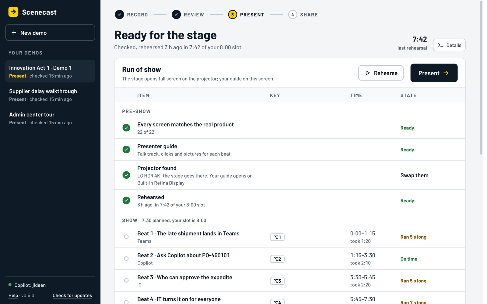

# Scenecast

Record a live web demo once. Present it the same way every time, offline.

## Why Scenecast

Live demos go wrong on stage: the network is slow, a sign-in expires, an AI answer comes out different. Scenecast
takes that risk away.

- **Record it once**, in your own browser, clicking through the way you'll present it. Or let GitHub Copilot click
  through for you.
- **Scenecast makes a replica** from the real pages, so it looks exactly like the product. It needs no network and no
  sign-ins, and it does the same thing every time.
- **Present from it**, with a guide on your laptop: what to say, what to click, and the clock against your slot.

It's for anyone who shows a web app on stage or on a call: PMs, marketers, engineers, DevRel. No terminal needed.

## Get Scenecast

| | Mac | Windows |
|---|---|---|
| **Download** | [Scenecast for Mac](https://github.com/jldeen/scenecast/releases/latest/download/Scenecast-mac.dmg) | [Scenecast for Windows](https://github.com/jldeen/scenecast/releases/latest/download/Scenecast-windows-setup.exe) |
| **Install** | Open it and drag Scenecast to Applications. | Run it. It installs just for you, no admin needed. |
| **The first time you open it** | If macOS says it can't check the app, open **System Settings → Privacy & Security** and click **Open Anyway**. | If Windows says it protected your PC, click **More info → Run anyway**. |

You also need Microsoft Edge or Google Chrome, signed in to the apps your demo shows. Other versions are on the
[releases page](https://github.com/jldeen/scenecast/releases).

## Your first demo

1. **New demo.** Name it and add the apps it shows (each one's start page). Paste your talk track if you have one.
2. **Record.** The first time, Scenecast helps you add its recorder to your browser: one step, once. Then click
   **Start recording** and go through your demo, or let Copilot click for you.
3. **Review.** Scenecast checks each screen of the replica against the real product, says why if one differs, and
   can fix it.
4. **Present.** **Rehearse** once with the clock running, then **Present**: the demo opens full screen on the
   projector, and your guide on your laptop.
5. **Share** (optional). Make one file for another presenter. They double-click it, and it's ready to rehearse.

The [one-page guide](docs/guide.md) ([PDF](docs/guide.pdf)) has every step, with pictures.

## On stage

Hold **⌥** on a Mac, or **Ctrl+Alt** on Windows, and press:

| Key | What it does |
|---|---|
| **0** | Back to the start |
| **1** to **9** | Jump to a beat |
| An app's letter | Switch to that app (Present lists them) |
| **F**, **Shift+F** | Zoom to the next thing you talk about, or back one. **Esc** zooms out. |
| **P** | Type the prompt you typed when you recorded (you press Enter) |
| **N** | The screen's next step |
| **G** | Open your guide |

With a clicker, **Page Down** in your guide moves the demo on, and **Page Up** goes back. If anything looks wrong,
**⌥0** (**Ctrl+Alt+0**) puts everything back to the start.

## Updates

Scenecast checks for new versions by itself. When there is one, **Update to vX.Y.Z** shows at the bottom left. Click
it: Scenecast installs it and restarts, and your demos stay as they are. It waits while you're recording or
presenting.

## Help

- The guide's [when something's wrong](docs/guide.md#4--when-somethings-wrong) table covers the common problems.
- In Scenecast, **Details → Copy diagnostics** gives you one block of text to paste when you ask for help.
- [Open an issue](https://github.com/jldeen/scenecast/issues), or message Jessica with the demo's name and a
  screenshot.

## More

- [The presenter guide](docs/presenter.md): your laptop's window while you present
- [Copilot in Scenecast](docs/ai.md): what it does for you, and what it sees
- [All the docs](docs/README.md): the command line, how Scenecast works, building and releasing it
- For AI agents working on this repository: [AGENTS.md](AGENTS.md)

Scenecast grew out of Seth Juarez's `.scenecast` bundle format and CLI.
