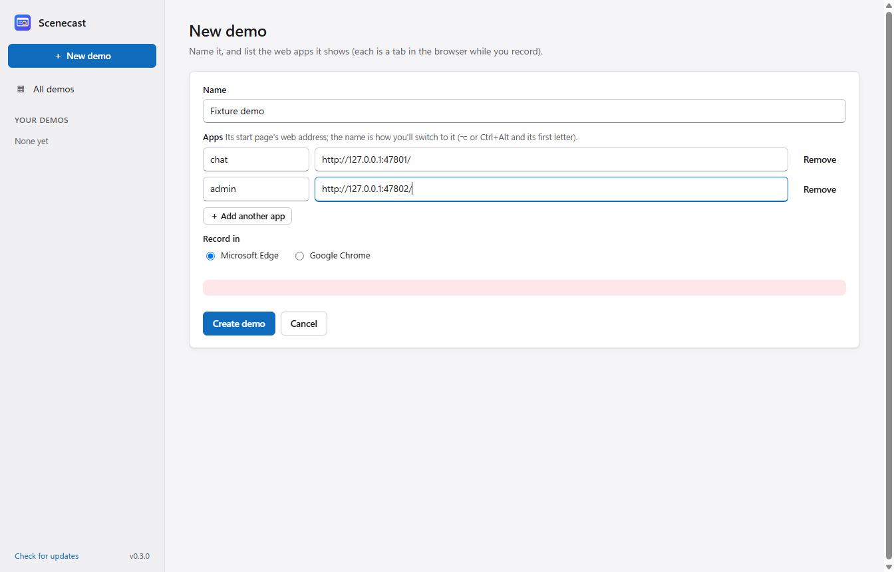
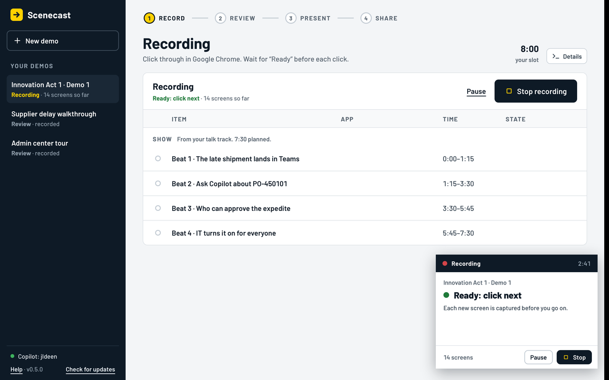
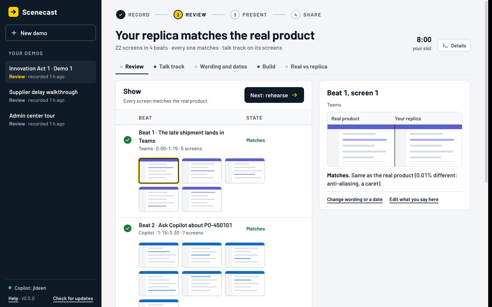
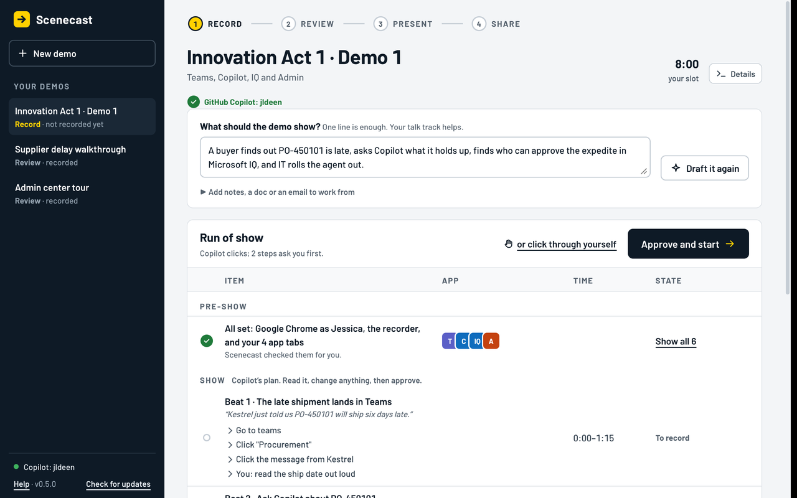
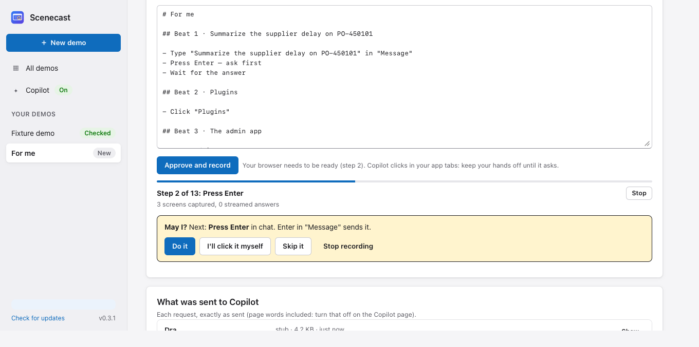
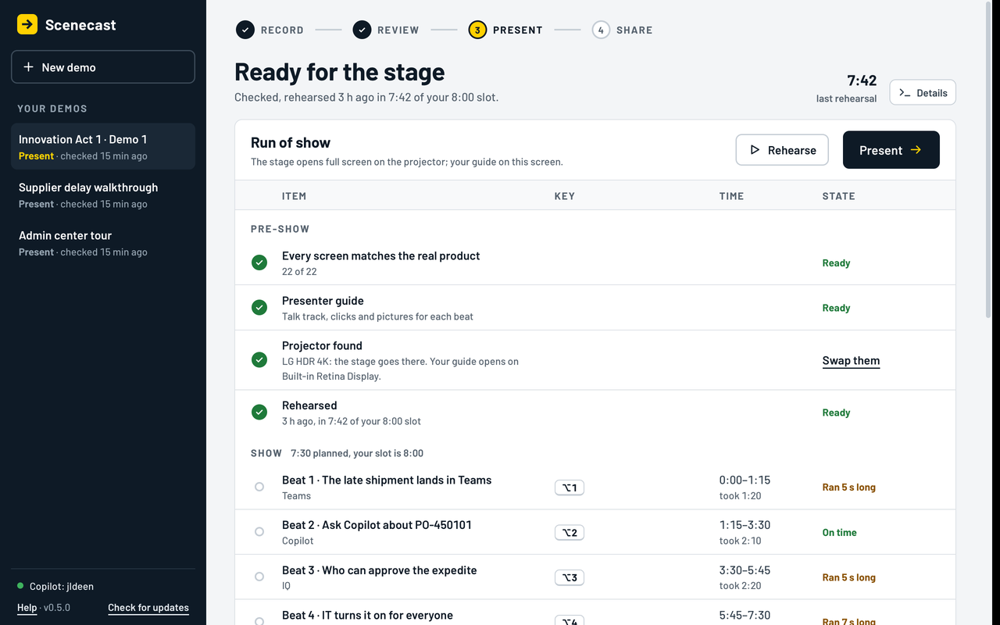
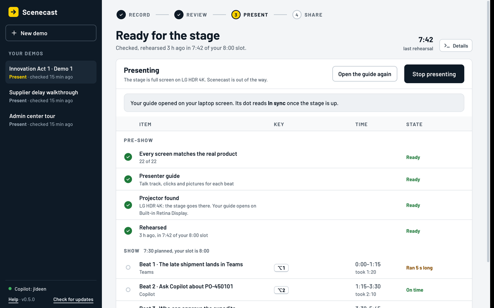
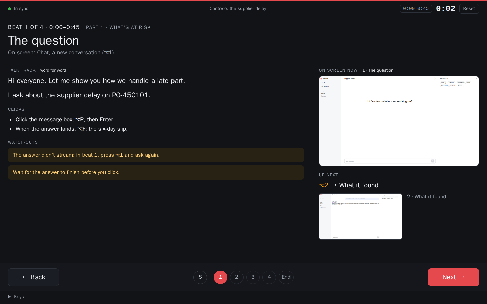
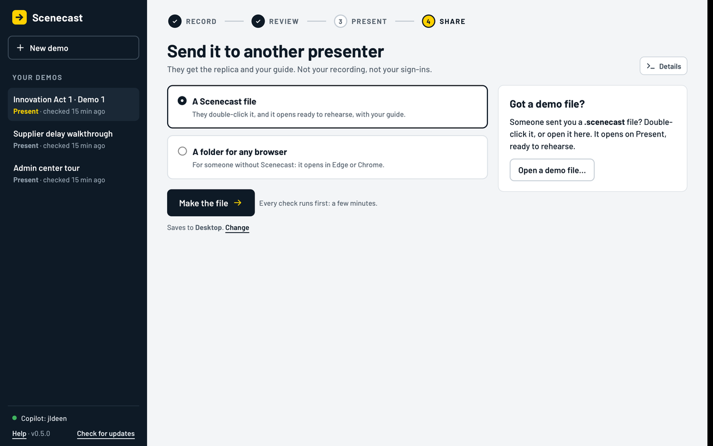

# The Scenecast app

The way presenters use Scenecast: one window for the whole demo, from making it to presenting it, on macOS and
Windows, with Edge or Chrome. No terminal. (The `scenecast` CLI does the same underneath, for automation and CI.)


## Install

From the [latest release](https://github.com/jldeen/scenecast/releases/latest):

- **macOS** (Apple silicon and Intel): `Scenecast_<version>_universal.dmg`. Open it and drag Scenecast to Applications.
- **Windows**: `Scenecast_<version>_x64-setup.exe` (installs for you only, no admin), or the `.msi`.

The app carries what it needs (its engine and Node). You need Microsoft Edge or Google Chrome. Until the installers
are signed ([signing.md](signing.md)), each system asks once: on the Mac, System Settings → Privacy & Security → **Open
Anyway**; on Windows, SmartScreen's "Windows protected your PC" → **More info** → **Run anyway**. The
[one-page guide](../guide.md) walks a presenter through it ([PDF](../guide.pdf)).

Every green CI run on `main` also has the installers as artifacts (`scenecast-macOS-installers`,
`scenecast-Windows-installers`).

Your demos are kept in `Documents/Scenecast`.

## A demo, step by step

Four steps along the top of every demo: **Record**, **Review**, **Present**, **Share**. Each screen has one next step.

| Step | What you do |
|---|---|
| **First run** | Scenecast finds your browser and the profile you work in, and adds the recorder with you once (the folder, then a drag onto the extensions page, with pictures). It turns green by itself when the recorder connects. |
| **New demo** | Name it, and tick its apps from your open tabs: Microsoft product pages are ticked to start with (mail, sign-in and docs pages aren't), each named from its address. Or type a start page in. Optional: your talk track (each `##` heading starts a beat, with its time, like `(0:00–1:15)`) and your slot. The button says what it makes: **Create with 4 apps**. |
| **Record** | The run of show. **Pre-show**: your browser, the recorder and each app's tab, checked when you open it ("All set" when it's ready); anything that isn't has its own fix (Which tab is it?, Sign in, Add the recorder). **Show**: your talk track's beats with their times. **Start recording** checks again with its fixes (it opens a tab that isn't open, and keeps the new address of one that moved) and starts. While you record, a small window stays on top of the browser: **Ready: click next** or **Hold on: capturing**, the screens so far, **Pause** and **Stop**. Closing the browser's "debugging" bar pauses it; **Pick up where I left off** goes on with every screen kept. |
| **…or let Copilot click** | On Record: **or let Copilot click for you**. Say what to show; **Draft the plan** (from your words and each app's start screen); read it in the run of show; **Approve and start**. Copilot clicks in your browser while it records, and asks **May I?** before anything that sends or changes something (Do it, I'll click it, Skip). **Coach me** shows the next step and what to say while you click. All through your own GitHub Copilot sign-in ([ai.md](../ai.md)); **What was sent to Copilot** lists every request. |
| **Review** | After Stop, the replica is made on its own, no button: built (email addresses, names and IDs taken out; a password, key or token stops it) and your talk track put on its screens. Then it's ready to present, about a minute after Stop. Every screen is compared with the real product in the background (Review fills in as each one is done), then the quick checks. Review shows each beat with its screens; pick one to see it next to the real product, and why it differs in a sentence. One next step: **Fix it for me** (finds why, changes this demo, builds and compares again, never with a screenshot) or **Next: rehearse**. Beside it: **Talk track** (paste or open it; the line-to-screen and cue sheets; your guide), **Wording and dates** (the replica in edit mode: change a word or a date, add a focus point), and the **Build** and **Real vs replica** in full. |
| **Present** | A ready check first: every screen matches, your guide is made, you've rehearsed, and the projector is found. **Rehearse** runs it with the clock going and keeps each beat's time; the run of show shows planned against rehearsed. **Present** opens the stage full screen on the projector and your guide on the laptop (**Swap them** if they're the wrong way round). The keys for this computer: ⌥ on a Mac, Ctrl+Alt on Windows. A clicker's Page Down moves the stage on. |
| **Share** | **A Scenecast file** (they double-click it and it opens ready to rehearse, with your guide) or **a folder for any browser** (for someone without Scenecast). Every check runs first. Not your recording, not your sign-ins. |

**Fast checks.** A small change never runs the whole checklist. After a build, a talk track or an edit, only what the
change touched is checked (and the keys, focus points or guide if those changed), a minute or two. The whole checklist
runs once, when you share.

From the library: open, duplicate (with its recording) or delete (to the Trash or Recycle Bin) any demo, with where
each one stands.

## Screens

| | |
|---|---|
|  New demo, from your open tabs |  Record: the run of show |
|  Recording, with the window on top of the browser |  Review: each beat's screens, next to the real product |
|  Copilot: the plan in the run of show |  Copilot asks before a send |
|  Present: the ready check and the keys |  Presenting, with your guide |
|  Your guide, on the laptop screen |  Share: a Scenecast file, or a folder |

## Why the replica opens in Edge or Chrome

The app's own window is a system webview: WebView2 (Edge's engine) on Windows, but WebKit (Safari's) on the Mac. The
replica is captured in, and its fidelity measured in, Chromium; so editing and presenting happen in an Edge or Chrome
app window (no tabs or address bar, full screen for presenting), the same on both systems.

## For developers

```bash
npm ci && npx playwright-core install chromium      # the repository root: the engine, and the test's browser
cd apps/desktop && npm ci
npx tauri dev                                        # the app, from source (Linux needs the WebKitGTK packages)
npm run build:test && npm run test:ui                # the UI test: the whole flow on the fixture app
```

- `crates/scenecast-app`: the commands the window calls (library, record, build and checks, fidelity, script,
  the presenter guide (`guide`: notes, pictures, opening it on the app's screen), servers for edit and present, key
  reference, export (with the whole checklist first), what the window may show from the library (on the app's `scenecast:` protocol), the update stub), each
  with a typed result and serializable progress. Unit-tested in the main workspace on Ubuntu, macOS and Windows.
- `apps/desktop/src-tauri`: the Tauri shell (its own Cargo workspace): commands, `job` events, one job per demo at a
  time. Built with `--features webdriver`, it has an embedded WebDriver server for the UI test; installers never do.
- `apps/desktop/ui`: the window, plain HTML, CSS and JavaScript (no build step), in the look described in
  [design.md](design.md): keyboard reachable, labelled for screen readers, progress announced.
- `apps/desktop/tests/ui.test.mjs`: WebdriverIO against the real app window (the embedded WebDriver server works on
  macOS, Windows and Linux). CI runs it on macOS and Windows; `SCENECAST_UI_SHOTS=<dir>` saves each screen.
- Installers: `scripts/prepare-bundle.mjs` (Node, checked by SHA-256; signing when its secrets are set), then
  `tauri build`. See [signing.md](signing.md).
- App updates: the Tauri updater plugin reads `latest.json` from the newest GitHub release (signed with the updater
  key; its public half is in `tauri.conf.json`, the private half is the `TAURI_SIGNING_PRIVATE_KEY` secret). The app
  checks at start, every 30 minutes and when its window comes back to the front; a newer version shows at once (a dot
  on Check for updates, and **Update to vX.Y.Z**), which downloads, installs and restarts (not while recording or
  presenting). The release job writes
  `latest.json` (`scripts/latest-json.mjs`) when the installers were built with the key.
- `apps/desktop/tests/packaged.test.mjs`: the installers themselves, installed and started as a presenter would
  (CI, macOS and Windows): receiver, extension connecting in Chrome on a non-Default profile, Fix, Install recorder.
  `apps/desktop/tests/update.test.mjs`: version N updating to N+1 served locally. Both drive the app through its
  test hook (`SCENECAST_SELFTEST=<folder>`), which runs the same code as the window's buttons.
- The Install recorder pictures: `node apps/desktop/scripts/setup-shots.mjs` (the real extensions pages).

The screenshots here come from the UI test (`SCENECAST_UI_SHOTS`).
