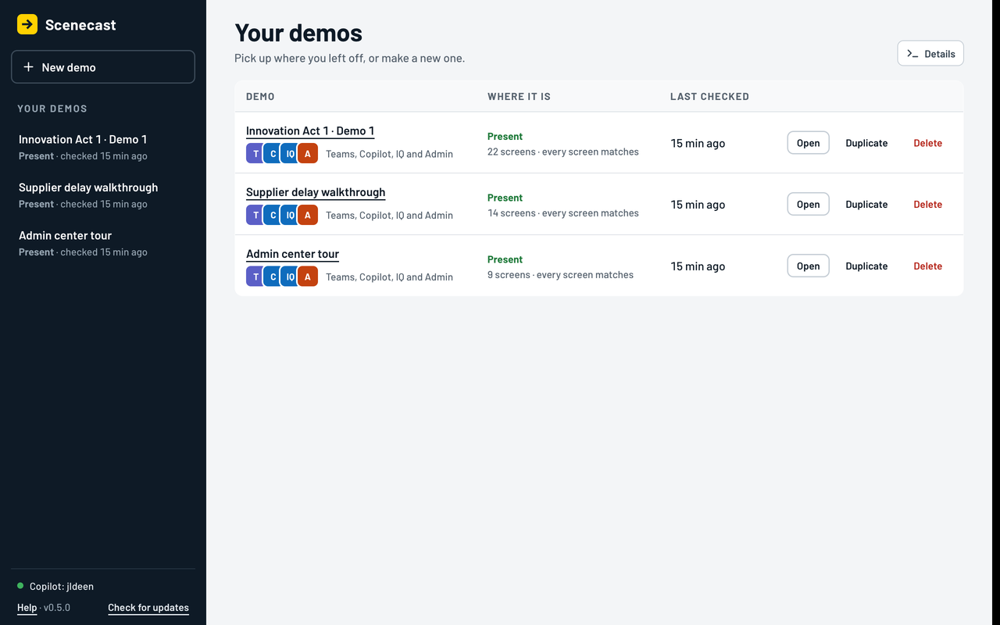
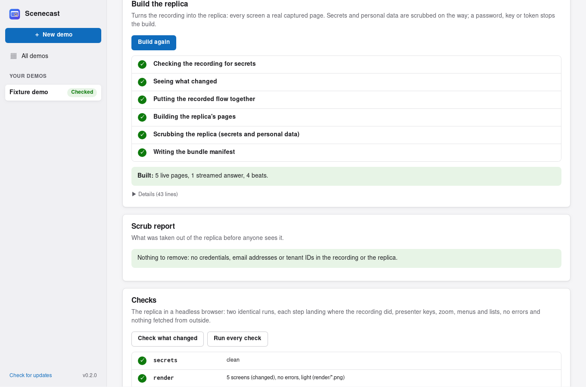
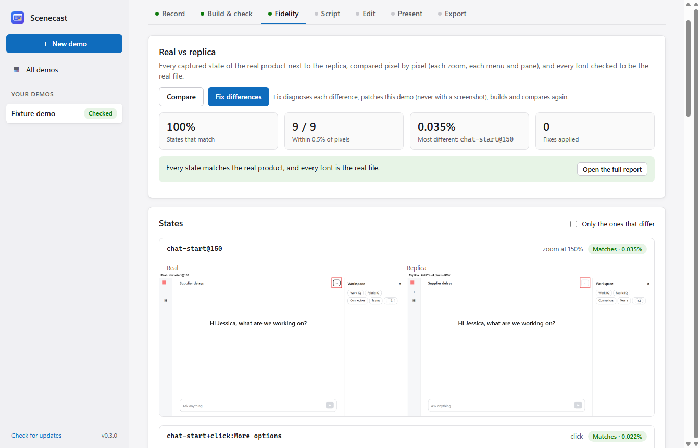

# The Scenecast app

The way presenters use Scenecast: one window for the whole demo, from making it to presenting it, on macOS and
Windows, with Edge or Chrome. No terminal. (The `scenecast` CLI does the same underneath, for automation and CI.)



## Install

From the [latest release](https://github.com/jldeen/scenecast/releases/latest):

- **macOS** (Apple silicon and Intel): `Scenecast_<version>_universal.dmg`. Open it and drag Scenecast to Applications.
- **Windows**: `Scenecast_<version>_x64-setup.exe` (installs for you only, no admin), or the `.msi`.

The app carries what it needs (its engine and Node). You need Microsoft Edge or Google Chrome. Until the installers
are signed ([signing.md](signing.md)), each system asks once: on the Mac, System Settings → Privacy & Security → **Open
Anyway**; on Windows, SmartScreen's "Windows protected your PC" → **More info** → **Run anyway**. The
[one-page guide](../guide.md) walks a presenter through it ([PDF](../guide.pdf)).

Every green CI run on `main` also has the installers as artifacts (`scenecast-macOS-installers`,
`scenecast-Windows-installers`).

Your demos are kept in `Documents/Scenecast`.

## A demo, step by step

| Step | What you do |
|---|---|
| **New demo** | Name it, list its apps (each one's start page: a tab while you record), pick Edge or Chrome. |
| **Record** | Set up the recorder once (it builds the extension and shows you the three clicks to load it in your browser). **Check** says whether everything's ready: the receiver, your browser and profile, the recorder, each app's tab (open, light theme, on its start screen); **Check and fix** puts right what it can, and never restarts a browser you already have open. Then **Start recording** and run the demo once: the app shows each screen as it's captured, the side states being swept, and the recorder's time apart from the product's. **Stop recording**. |
| **Build & check** | Turns the recording into the replica, scrubbing secrets and personal data on the way (the scrub report lists what was removed; a password, key or token stops the build). Then the checks for what changed run on their own. |
| **Fidelity** | Every captured state of the real product next to the replica, compared pixel by pixel, with the fonts. **Fix differences** diagnoses each one, patches this demo, builds and compares again. |
| **Script** | Paste your script or open it (text, Markdown or RunLines `.sk`). **Find the focus points** puts each line on its screen and makes its focus points; the line-to-screen sheet and the cue sheet show here. The same script becomes the **presenter guide** (its notes and a picture per beat). Then the checks for what changed. |
| **Edit** | Opens the replica in edit mode in Edge or Chrome: add dots, change wording and dates, set beat starts. Each saved change is listed in the app as it happens. **Stop editing** runs the checks for what the edits touched. |
| **Present** | The presenter keys on one page first, and the presenter guide's. **Start presenting** opens the replica full screen in Edge or Chrome and, ticked by default, the [presenter guide](../presenter.md) on the screen the app is on (the laptop's); the app steps out of the way. **Open presenter guide** opens it again. **Stop presenting** when you're done. |
| **Export** | Every check first (two identical runs, cold starts, every zoom, focus points, the presenter guide), unless it already passed and nothing changed since; a failing check stops it, with **Export anyway**. Then the replica as a plain folder or a zip, for another presenter: they open `index.html`, no install. |

**Fast checks.** A small change never runs the whole checklist. After a build, a script or an edit, the app runs
`quick`: only the screens and states the change touched (and the keys, focus points or presenter guide if those
changed), a minute or two. The whole checklist runs once, on Export.

From the library: open, duplicate (with its recording) or delete (to the Trash or Recycle Bin) any demo, with where
each one stands: recorded, built, fidelity score, focus points, last checked.

## Screens

| | |
|---|---|
|  New demo |  Record: the recorder and preflight |
|  Recording, live |  Build, scrub report, checks |
|  Fidelity: real vs replica |  Script to focus points |
|  Edit: saved changes |  Present: the keys and the presenter guide |
|  The presenter guide, on the laptop screen |  Export: every check, then the folder or zip |
|  The library | |

## Why the replica opens in Edge or Chrome

The app's own window is a system webview: WebView2 (Edge's engine) on Windows, but WebKit (Safari's) on the Mac. The
replica is captured in, and its fidelity measured in, Chromium; so editing and presenting happen in an Edge or Chrome
app window (no tabs or address bar, full screen for presenting), the same on both systems.

## For developers

```bash
npm ci && npx playwright-core install chromium      # the repository root: the engine, and the test's browser
cd apps/desktop && npm ci
npx tauri dev                                        # the app, from source (Linux needs the WebKitGTK packages)
npm run build:test && npm run test:ui                # the UI test: the whole flow on the fixture app
```

- `crates/scenecast-app`: the commands the window calls (library, record, build and checks, fidelity, script,
  the presenter guide (`guide`: notes, pictures, opening it on the app's screen), servers for edit and present, key
  reference, export (with the whole checklist first), what the window may show from the library (on the app's `scenecast:` protocol), the update stub), each
  with a typed result and serializable progress. Unit-tested in the main workspace on Ubuntu, macOS and Windows.
- `apps/desktop/src-tauri`: the Tauri shell (its own Cargo workspace): commands, `job` events, one job per demo at a
  time. Built with `--features webdriver`, it has an embedded WebDriver server for the UI test; installers never do.
- `apps/desktop/ui`: the window, plain HTML, CSS and JavaScript (no build step). Light, Fluent and macOS conventions,
  keyboard reachable (arrow keys between steps), labelled for screen readers, progress announced.
- `apps/desktop/tests/ui.test.mjs`: WebdriverIO against the real app window (the embedded WebDriver server works on
  macOS, Windows and Linux). CI runs it on macOS and Windows; `SCENECAST_UI_SHOTS=<dir>` saves each screen.
- Installers: `scripts/prepare-bundle.mjs` (Node, checked by SHA-256; signing when its secrets are set), then
  `tauri build`. See [signing.md](signing.md).
- App updates: `scenecast_app::updates::check` is a stub ("Check for updates" in the window calls it). An update
  service would plug in there (the Tauri updater plugin with a signed feed).

The screenshots here come from the UI test (`SCENECAST_UI_SHOTS`).
