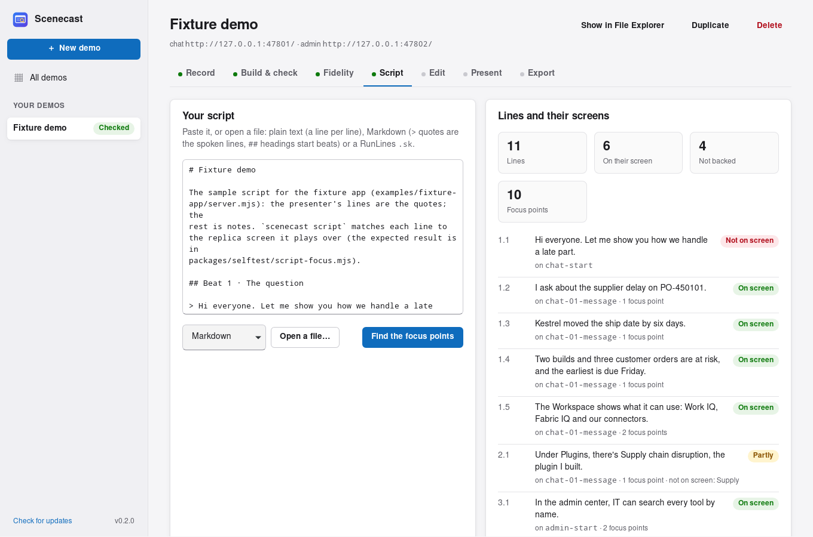

# Scenecast: the one-page guide

Scenecast turns a live web demo into a **replica** you present from: the real pages, captured once, that work the
same way every time, offline. No sign-ins on stage, no slow answers, no surprises. You do it all in the Scenecast
app, in about an hour for a first demo. No terminal.

You need: a Mac or a Windows PC, **Microsoft Edge** or **Google Chrome**, and the demo's apps signed in, in that
browser, in **light** theme.

## 1 · Install (once)

Download the installer from the latest release:
[github.com/jldeen/scenecast/releases/latest](https://github.com/jldeen/scenecast/releases/latest) (ask Jessica for
access if the page says it's not found).

| | Mac | Windows |
|---|---|---|
| Download | `Scenecast_<version>_universal.dmg` | `Scenecast_<version>_x64-setup.exe` (or the `.msi`) |
| Install | Open it, drag **Scenecast** to **Applications**. | Run it. It installs just for you; no admin needed. |
| The first time it opens | macOS says it can't check the app. Click **Done**. Open **System Settings → Privacy & Security**, scroll down to "Scenecast was blocked", click **Open Anyway**, then **Open Anyway** again and your password. | If Edge says the file "isn't commonly downloaded": **…** → **Keep** → **Show more** → **Keep anyway**. When Windows says "Windows protected your PC": **More info** → **Run anyway**. |

You only do the "open anyway" step once. (The installers aren't signed yet; when they are, it goes away.) Your demos
are kept in **Documents/Scenecast**.

## 2 · Your first demo

1. **New demo.** Name it, add each web app it shows (its start page's address), pick Edge or Chrome.
2. **Record → Set up the recorder** (once per browser). Scenecast shows the three clicks: open
   `edge://extensions` (or `chrome://extensions`), turn on **Developer mode**, **Load unpacked**, pick the folder it
   shows you.
3. **Record → Check** (or **Check and fix**). Every line should go green: the receiver, your browser, the recorder,
   each app's tab (open, light, on its start screen). "Fix" puts right what it can; a dark app needs its theme set to
   **Light** (not System) in its own settings.

   

4. **Start recording**, then run the demo once, the way you'll present it, in your browser. **Wait for "Ready for
   your next step"** before each click: Scenecast captures each screen and everything you could hover or open on it.
   **Stop recording** at the end. (A "started debugging this browser" bar shows while it records: leave it.)

   

5. **Build & check → Build.** The recording becomes the replica. Passwords, emails and tenant IDs are scrubbed on
   the way (the scrub report lists what came out). The checks for what changed then run on their own.
6. **Fidelity → Fix differences.** Every screen of the real product next to the replica, compared pixel by pixel.
   Fix repairs what differs and compares again. Aim for every state matching.

   

7. **Script.** Paste your script (or **Open a file…**: plain text, Markdown or a RunLines `.sk`) and press **Find
   the focus points**. Each line lands on its screen, with focus points: the spots the replica zooms to as you talk.
   The same script becomes your **presenter guide** (below).

   

8. **Edit** (if you need to). **Open the editor**: the replica opens in your browser. Click something to add a focus
   point; drag across words to change wording or a date everywhere it appears; set where a beat starts. **Stop
   editing** when done: Scenecast checks just what you changed, in a minute or two.
9. **Present → Start presenting.** The replica opens full screen; Scenecast steps out of the way.
10. **Export** (to hand it to someone else). Every check runs once, here, then you get a folder or a zip. They open
    `index.html` in Edge or Chrome: no install.

## 3 · Presenting, with the presenter guide

The **presenter guide** is a second window for your laptop screen: your talk track word for word, what to click, the
watch-outs, a timer against your script's times, and a picture of what's on screen now and what's next. It follows
the stage as you go.

1. Plug in the projector (extended display, not mirrored).
2. **Present → Start presenting**, with **Open the presenter guide on this screen too** ticked. The stage goes full
   screen; the guide opens on the screen Scenecast was on.
3. If they're on the wrong screens, swap them: drag the guide to your laptop; move the stage to the projector (Mac:
   ⌃⌘F to leave full screen, drag, ⌃⌘F; Windows: **Win+Shift+→**).
4. Press **⌥0** (Windows: **Ctrl+Alt+0**) on the stage. The guide's dot reads **In sync**.
5. In the guide, **← →** read ahead or back without moving the stage; **Esc** comes back; **Go to this beat on
   stage** moves the stage there. **Reset** restarts the timer for the beat.

| Mac | Windows | On the stage |
|---|---|---|
| **⌥0** | **Ctrl+Alt+0** | Back to the start |
| **⌥1 … ⌥9** | **Ctrl+Alt+1 … 9** | Jump to a beat |
| **⌥ + an app's letter** | **Ctrl+Alt + the letter** | Switch app |
| **⌥F**, **⌥⇧F** | **Ctrl+Alt+F**, **Ctrl+Alt+Shift+F** | Zoom to the next focus point, or back one (**Esc** zooms out) |
| **⌥P** | **Ctrl+Alt+P** | Type the scripted prompt (you press Enter) |
| **⌥N** | **Ctrl+Alt+N** | The screen's next scripted step |
| **⌥G** | **Ctrl+Alt+G** | Open the presenter guide |

Present → **Before you start** shows these for your demo. Rehearse once on the real display before the session.

## 4 · When something's wrong

| What you see | What to do |
|---|---|
| The app won't open the first time | The "open anyway" step in section 1. |
| **Check** says the recorder isn't there | **Set it up** and do the three clicks; or press the reload ↻ on the Scenecast card in `edge://extensions`. |
| **Check** says an app is dark | Set that app's theme to **Light** (not System) in its settings, then **Check** again. |
| **Check** says the browser isn't running with your profile | Close the stray window it opened, open your browser normally, **Check and fix**. |
| Recording seems stuck on "capturing this screen" | Wait: hovers and menus on a new screen take a little while. Don't click until it says "Ready for your next step". |
| The browser paused the recorder for a moment | Nothing to do: it picks the recording up where it left off, by itself. If you clicked **Cancel** on the debugging bar, the recording stopped: **Start recording** and run the demo again. |
| The build stopped: "credentials found" | A password, key or token was on screen while recording. Record that part again without it. |
| A check fails after an edit | Its line says what: usually a focus point on words that aren't on that screen. Move the dot under Edit. |
| Export says "Not exported yet" | The checks it lists failed. Fix them (Fidelity, Edit), or **Export anyway** if you accept them. |
| The guide says **Not connected** | It has to be in the same browser as the stage. Close it and use **Open presenter guide** in Scenecast, or press **⌥G** / **Ctrl+Alt+G** on the stage. |
| The guide shows a different beat | You're previewing: press **Esc** in the guide. Or press the beat's key on the stage. |
| The stage zoomed and won't come back | **Esc**. Still stuck: **⌥0** / **Ctrl+Alt+0**. |
| Anything else on stage | **⌥0** / **Ctrl+Alt+0** resets everything; then the beat's key. |

Stuck before the show? Message Jessica with the demo's name and a screenshot of the step.
