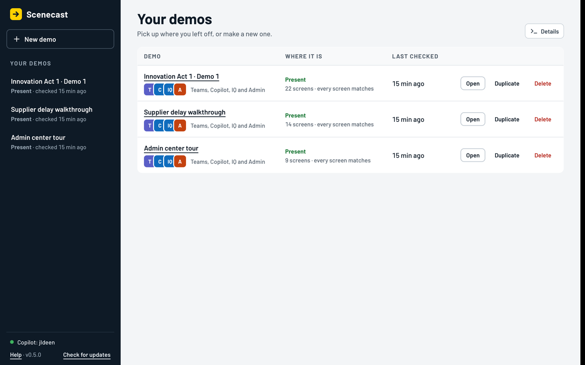
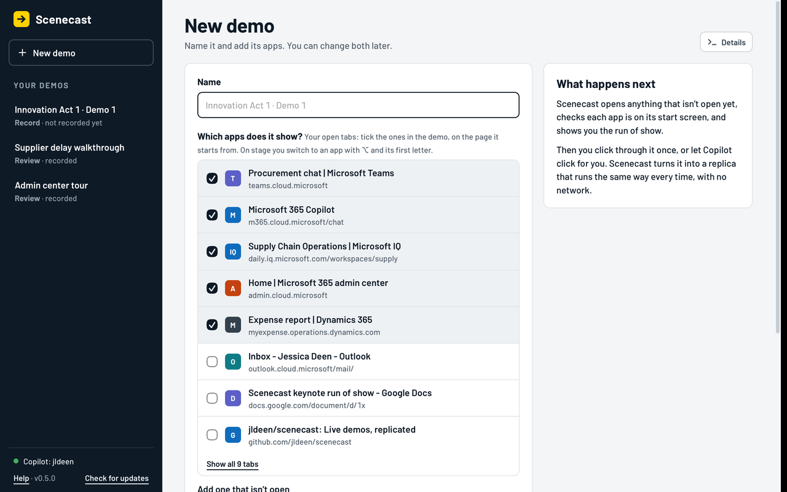
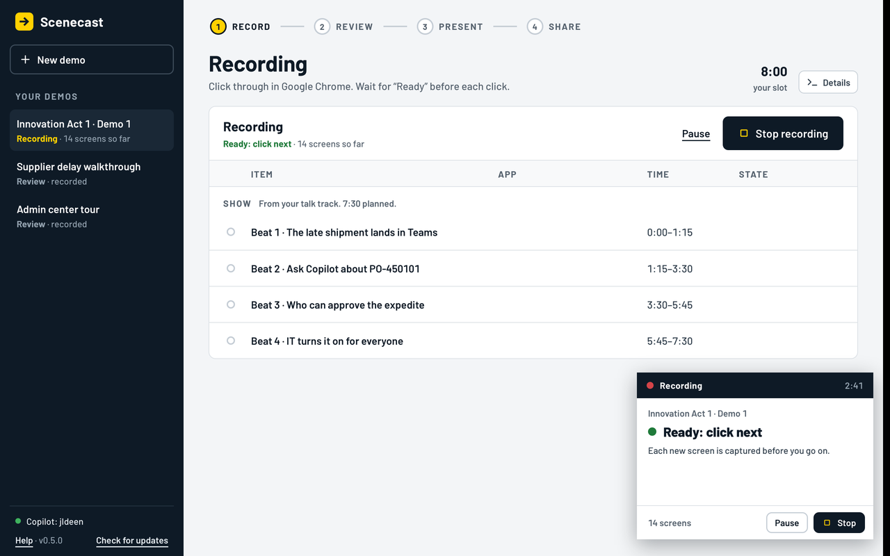
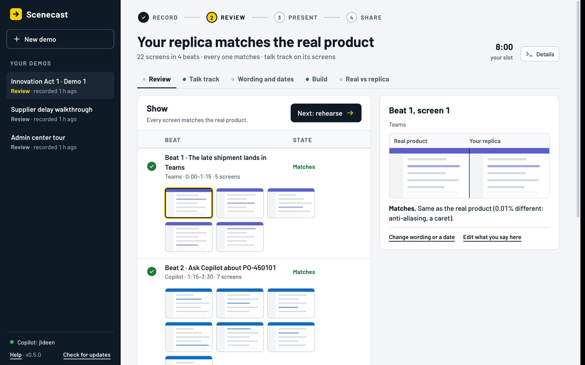
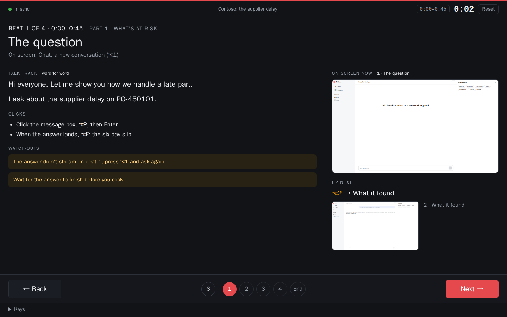

# Scenecast: the one-page guide

Scenecast turns a live web demo into a **replica** you present from: the real pages, captured once, that work the
same way every time, offline. No sign-ins on stage, no slow answers, no surprises. You do it all in the Scenecast
app, in about an hour for a first demo. No terminal.

You need: a Mac or a Windows PC, **Microsoft Edge** or **Google Chrome**, and the demo's apps signed in, in that
browser. Light or dark, each app is recorded as it looks.

## 1 · Install (once)

Download the installer from the latest release:
[github.com/jldeen/scenecast/releases/latest](https://github.com/jldeen/scenecast/releases/latest) (ask Jessica for
access if the page says it's not found).

| | Mac | Windows |
|---|---|---|
| Download | `Scenecast_<version>_universal.dmg` | `Scenecast_<version>_x64-setup.exe` (or the `.msi`) |
| Install | Open it, drag **Scenecast** to **Applications**. | Run it. It installs just for you; no admin needed. |
| The first time it opens | macOS says it can't check the app. Click **Done**. Open **System Settings → Privacy & Security**, scroll down to "Scenecast was blocked", click **Open Anyway**, then **Open Anyway** again and your password. | If Edge says the file "isn't commonly downloaded": **…** → **Keep** → **Show more** → **Keep anyway**. When Windows says "Windows protected your PC": **More info** → **Run anyway**. |

You only do the "open anyway" step once. (The installers aren't signed yet; when they are, it goes away.) Your demos
are kept in **Documents/Scenecast**.

**Updates:** when there's a new version, a yellow dot appears on **Check for updates** and **Update to vX.Y.Z** at the bottom
left (Scenecast checks by itself). Click it: it downloads, installs and restarts, and your demos stay as they are. (**Check for updates** asks now.)

## 2 · Your first demo

1. **Open your demo's apps** in Edge or Chrome, each on the page it starts from, signed in.
2. **New demo.** Name it, and tick its apps from your open tabs (Microsoft product pages are ticked already; mail
   isn't). Add your talk track if you have one: each `##` heading is a beat, with its time, like
   `## The late shipment lands (0:00–1:15)`. **Create.**

   

3. **Add the recorder** (the first time, once per browser). Scenecast shows the **Recorder Extension** folder (in
   Documents/Scenecast) in Finder or File Explorer and copies the extensions page's address. Paste it in your
   browser's address bar and press Enter, turn on **Developer mode**, and drag the folder onto the page. Scenecast
   turns green as soon as the recorder connects: nothing to type.
4. **Record.** The run of show checks your browser, the recorder and each app's tab: **All set**, or one fix for
   whatever isn't (it opens a tab that isn't open; it asks **Which tab is it?** if it can't find one). **Start
   recording**, then run the demo once, the way you'll present it. A small window stays on top of your browser:
   **wait for "Ready: click next"** before each click (Scenecast captures each screen and everything you could hover
   or open on it). **Pause** if you need to; **Stop** at the end. A "started debugging this browser" bar shows while it
   records: leave it (if you close it, the recording pauses; **Pick up where I left off**).

   

   **Or let Copilot click:** on Record, **or let Copilot click for you**. Say what the demo should show, **Draft the
   plan**, read it, then **Approve and start**. Keep your hands off the browser; when it asks **May I?** before a send
   or a save, say **Do it**, **I'll click it** or **Skip**. It writes your talk track from what happened. **Coach me**
   shows each next step and what to say while you click. Both use GitHub Copilot: on the **Copilot** page, **Sign in
   with GitHub** once ([more](ai.md)).
5. **Review.** When you stop, Scenecast makes the replica by itself: it builds it (passwords, emails and tenant IDs
   are taken out), puts your talk track on its screens, checks it, and compares every screen with the real product.
   Then each beat shows with its screens; pick one to see it next to the real product. If one differs, **Fix it for
   me**.

   

   Beside it: **Talk track** (paste or open it: plain text, Markdown or a RunLines `.sk`) puts each line on its screen
   with focus points, the spots the replica zooms to as you talk, and makes your presenter guide. **Wording and dates**
   opens the replica to change a word or a date everywhere it appears, or add a focus point.
6. **Present.** The run of show: what's ready before the show, then each beat with its key and its time. **Rehearse**
   once with the clock going (each beat's time is kept), then **Present**: the stage opens full screen on the
   projector, your guide on the laptop, and Scenecast steps out of the way.
7. **Share** (to hand it to someone else). Every check runs once, here. **A Scenecast file**: they double-click it
   and it opens in Scenecast on Present, ready to rehearse, with your guide. **A folder for any browser**: they open
   `index.html` in Edge or Chrome, no install. Neither has your recording or your sign-ins.

## 3 · Presenting, with the presenter guide

The **presenter guide** is a second window for your laptop screen: your talk track word for word, what to click, the
watch-outs, a timer against your script's times, and a picture of what's on screen now and what's next. It follows
the stage as you go.

1. Plug in the projector (extended display, not mirrored). Present says **Projector found** and its name.
2. **Present.** The stage goes full screen on the projector; the guide opens on your laptop's screen. If Scenecast has
   them the wrong way round, **Swap them** before you start.
3. Press **⌥0** (Windows: **Ctrl+Alt+0**) on the stage. The guide's dot reads **In sync**.
4. With a clicker, **Page Down** in the guide moves the stage on (the screen's next step, then the next beat) and
   **Page Up** back. **← →** read ahead or back without moving the stage; **Esc** comes back; **Go to this beat on
   stage** moves the stage there. **Reset** restarts the timer for the beat.

| Mac | Windows | On the stage |
|---|---|---|
| **⌥0** | **Ctrl+Alt+0** | Back to the start |
| **⌥1 … ⌥9** | **Ctrl+Alt+1 … 9** | Jump to a beat |
| **⌥ + an app's letter** | **Ctrl+Alt + the letter** | Switch app |
| **⌥F**, **⌥⇧F** | **Ctrl+Alt+F**, **Ctrl+Alt+Shift+F** | Zoom to the next focus point, or back one (**Esc** zooms out) |
| **⌥P** | **Ctrl+Alt+P** | Type the scripted prompt (you press Enter) |
| **⌥N** | **Ctrl+Alt+N** | The screen's next scripted step |
| **⌥G** | **Ctrl+Alt+G** | Open the presenter guide |

Present shows these for your demo, with each beat's key. **Rehearse** once on the real display before the session.

## 4 · When something's wrong

| What you see | What to do |
|---|---|
| The app won't open the first time | The "open anyway" step in section 1. |
| Record says the recorder isn't connected | **Add the recorder** and drag the folder in again; or press the reload ↻ on the Scenecast card in `chrome://extensions` or `edge://extensions`. |
| Record asks **Which tab is it?** | Pick the app's tab from the list (Scenecast keeps its address), or open it on its start page. |
| Record asks which profile | Pick the one you're signed in to the apps with. Scenecast remembers it. |
| The window on top says **Hold on** for a while | Wait: hovers and menus on a new screen take a little while. Click when it says **Ready: click next**. A click that came too early says so: do it again. |
| You closed the debugging bar | The recording paused, with every screen kept: **Pick up where I left off**. |
| Making the replica stopped: "credentials found" | A password, key or token was on screen while recording. Record that part again without it. |
| Review says a screen needs a look | **Fix it for me**. If it still differs, record that part again. |
| Review says a check fails | **See what fails**: usually a focus point on words that aren't on that screen. Move the dot under **Wording and dates**. |
| Share says "Not shared yet" | The checks it lists failed. Fix them on Review, or **Share it anyway** if you accept them. |
| Someone sent you a `.scenecast` file | Double-click it, or **Share → Open a demo file…**. It opens on Present. |
| The guide says **Not connected** | It has to be in the same browser as the stage. Close it and use **Open the guide again** in Scenecast, or press **⌥G** / **Ctrl+Alt+G** on the stage. |
| The guide shows a different beat | You're previewing: press **Esc** in the guide. Or press the beat's key on the stage. |
| The stage zoomed and won't come back | **Esc**. Still stuck: **⌥0** / **Ctrl+Alt+0**. |
| Anything else on stage | **⌥0** / **Ctrl+Alt+0** resets everything; then the beat's key. |

Stuck before the show? Message Jessica with the demo's name and a screenshot of the step.
